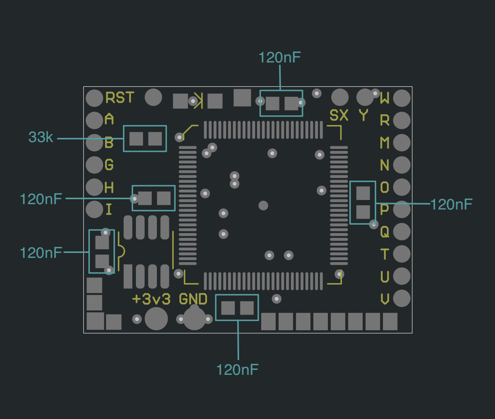
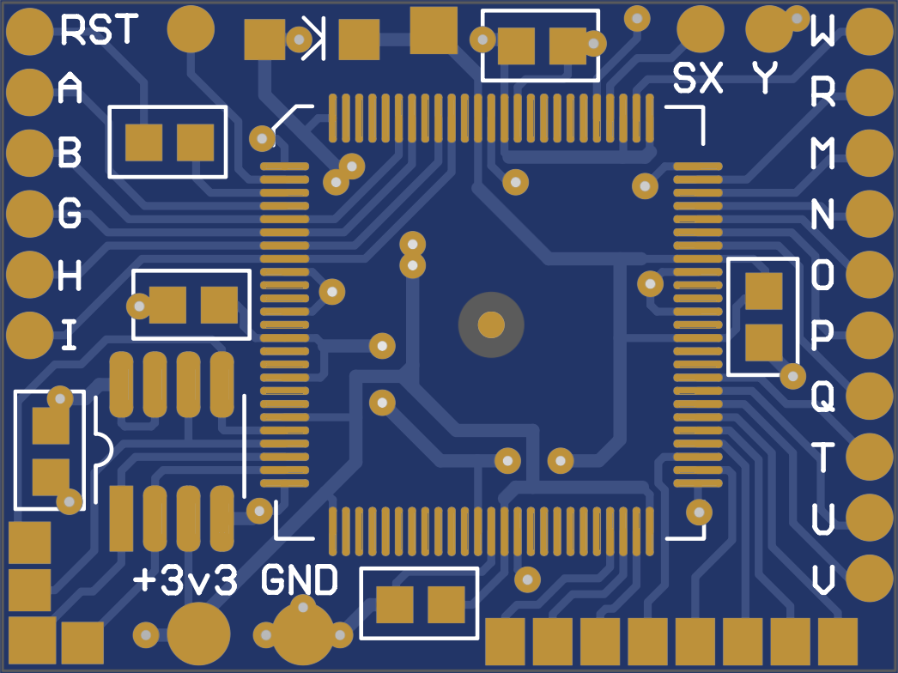
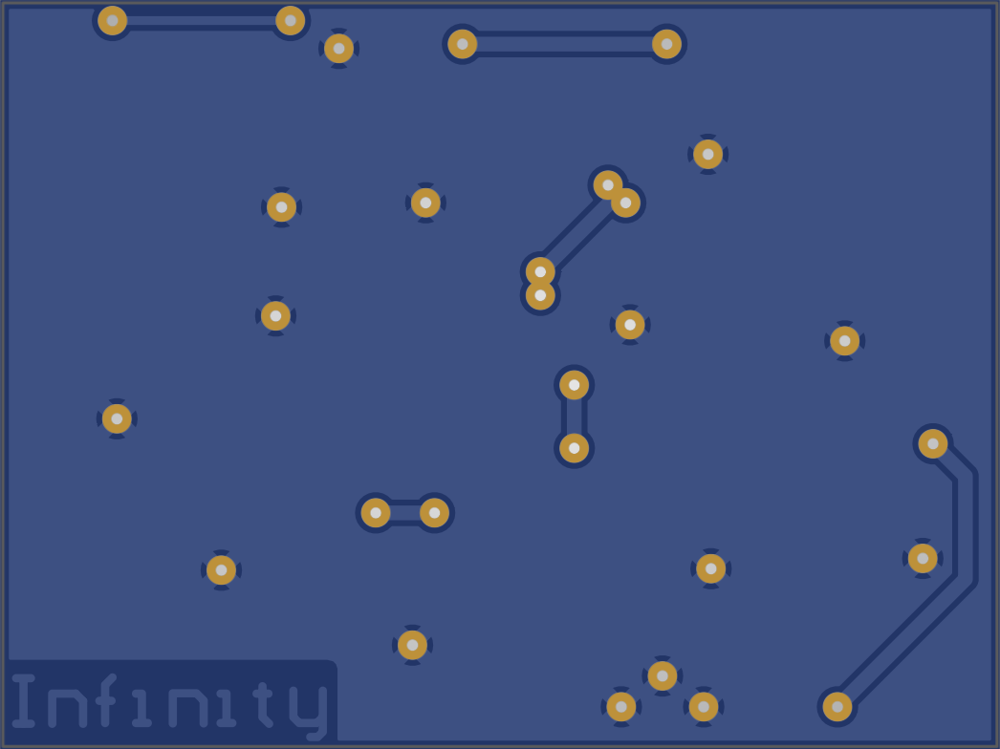
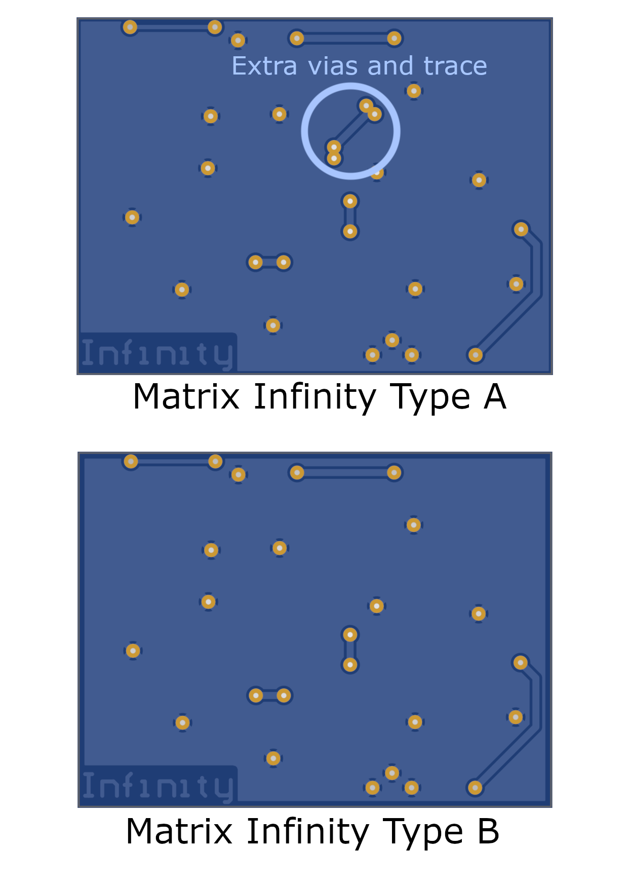

# Matrix Infinity Type A

The two versions have some PCB layout differences. Before ordering, carefully check the back of your original Matrix Infinity chip to identify whether it is a Type A or Type B. Make sure to select the corresponding replacement PCB, as the two versions are not interchangeable.

## [Download Gerber Files](https://github.com/atherismods/PS2-Modchip-PCB-Replacements/raw/refs/heads/main/Matrix_Infinity_A/gerber.zip)

# Diagram

# Render

  
  

# Comparison

