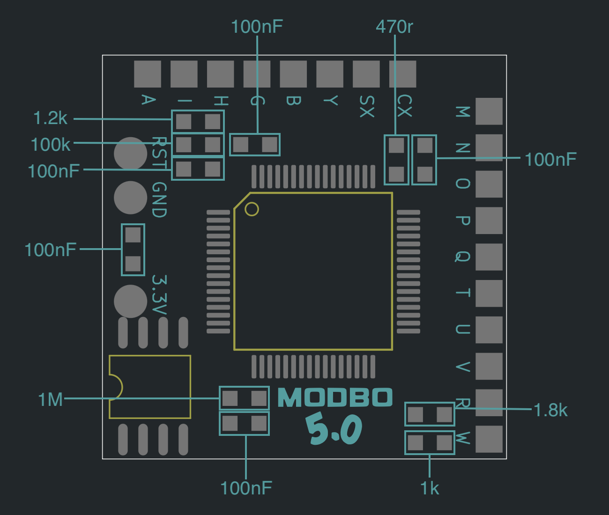
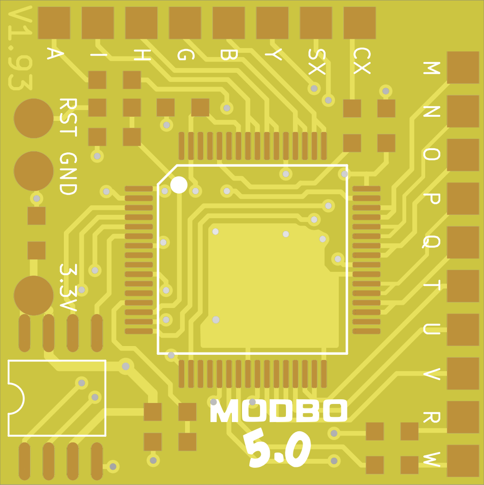
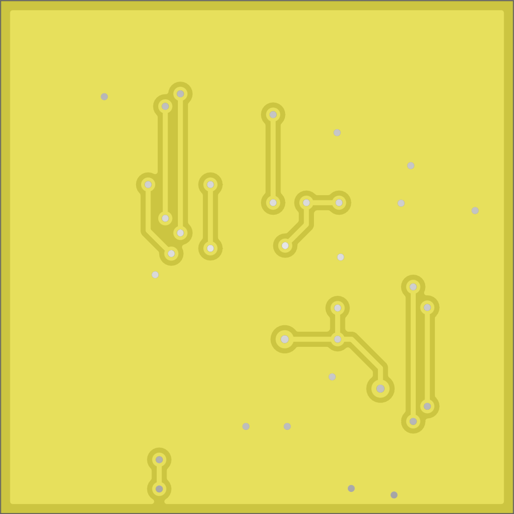
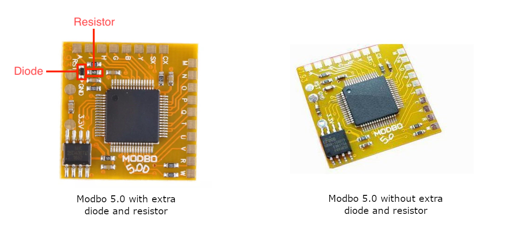

# Modbo 5.0

This replacement PCB is based on the original Modbo 5.0 design, with the aim of staying as faithful to the original layout as possible.

Most, if not all, Modbo 5.0 boards available today appear to include an additional diode and resistor. Neither component is connected to anything on the PCB, and neither serves any electrical purpose. I've therefore left them out of this recreation.

## [Download Gerber Files](https://github.com/atherismods/PS2-Modchip-PCB-Replacements/raw/refs/heads/main/Modbo_5.0/gerber.zip)

# Diagram

# Render

  
  

# Comparison

