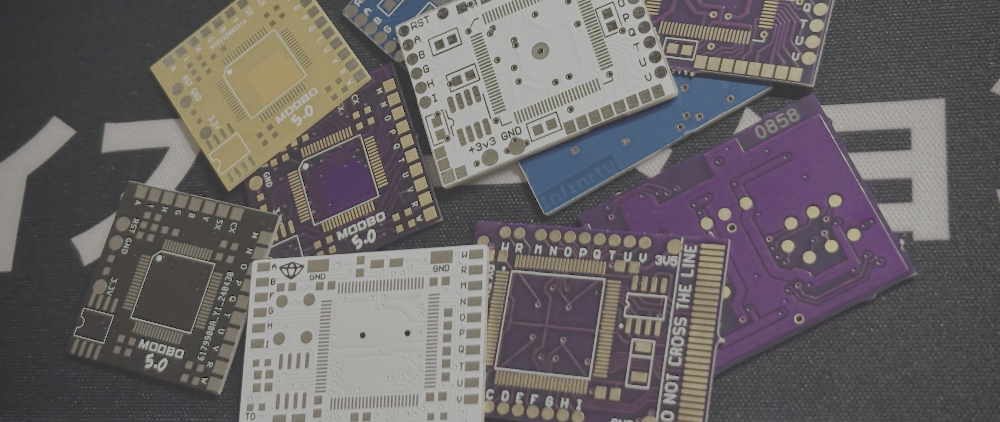
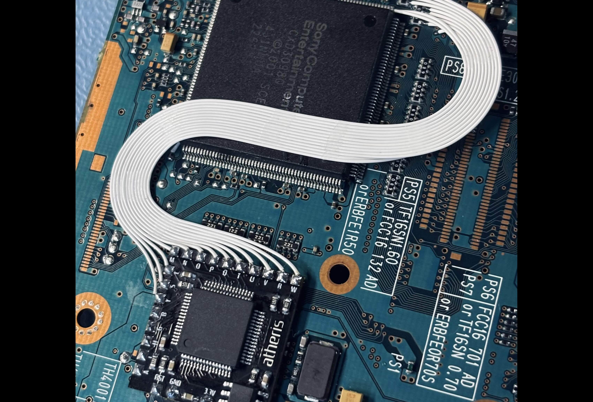

# PS2-Modchip-PCB-Replacements
Gerber files for replacement PCBs of PlayStation 2 modchips, intended for the repair and restoration of original boards.

Many of these boards are now around 20 years old, and it's increasingly common to find them with lifted pads, broken traces, or other damage. This repository exists to make faithful replacement PCBs available, helping to keep existing modchips repairable and in use.

The boards can also be ordered in different solder mask colours. Aside from personal preference, this provides a simple way to distinguish a replacement PCB from an original, which can be useful when identifying or documenting hardware.

I have a lot of respect for the people who originally designed these boards. These recreations are intended as a way of preserving and supporting their work, not replacing the originals or taking credit for their designs. I've tried to stay as true to the original layouts as possible.

# PCB Replacements

- [Crystal Chip 1.0](Crystal_Chip_1.0/README.md)
- [Ghost 2 V2](Ghost_2_V2/README.md)
- [Matrix Infinity A](Matrix_Infinity_A/README.md)
- [Matrix Infinity B](Matrix_Infinity_B/README.md)
- [Modbo 5.0](Modbo_5.0/README.md)

# Contents
- [About this project](#about-this-project)
- [What this repository is (and isn't)](#what-this-repository-is-and-isnt)
- [Intended use](#intended-use)
- [Verification](#verification)
- [Ordering](#ordering)
- [Help](#help)
- [Credits](#credits)
- [Issues](#issues)

# About this project

A couple of years ago, this was my first dive into PCB design, and I mostly did it for fun and practice. I'm passionate about the history of PS2 modchips, and I wanted to do something small to help preserve them. If these boards help keep a few more of the originals alive, that's a bonus.

With a little more experience, I also started experimenting with my own PCB designs to better suit my installation style.

# What this repository is (and isn't)
Gerber files, preview renders, and component value diagrams for replacement PCBs.

No schematics, firmware, or instructions for use.

# Intended use

These files are shared for the repair and restoration of existing modchips. Out of respect for the original designers and their work, I'd ask that they aren't used for commercial reproduction, resale of the files, or the development of new products.

The intention is simply to help preserve existing hardware and make repairs a little easier.

# Verification

The Modbo 5.0 has been tested by me, while both the Matrix Infinity Type A and Type B have been tested by a friend.

The remaining boards are simple two-layer designs, with their traces and vias recreated to match the originals. I expect them to work, but they haven't been physically tested or verified.

If you try one of the untested boards, please open an issue and let me know how it went. I'd really appreciate any feedback or test results.

# Ordering

Each board folder contains a .zip Gerber file that can be uploaded directly to JLCPCB's order page.

**Recommended fabricator:** JLCPCB. The Gerber files should work with other PCB manufacturers too.

**Board thickness: 1 mm.** This is important, as it matches the dimensions of the original PCBs. Make sure to select this when ordering, as 1.6 mm is usually the default.

# Help

Each board folder includes a diagram showing the passive component values, which may be useful when repairing or populating a board.

You might notice that the PCBs don't have component designators. This is intentional, as the original PCBs didn't have them either. I've included component value diagrams for reference where needed.

When populating a replacement PCB, components can simply be transferred from the original board, keeping them in their corresponding positions.

A hotplate is recommended when transferring components from the original damaged PCB to the replacement.

# Credits

- [Helder](https://github.com/Helder1981/) for getting me started with PCB design.

- [R3Z3N](https://github.com/saildot4k) for letting me depopulate and scan some of his modchips to help with these designs. He has also helped extensively with this project, including measuring components and testing boards. Check out his [PS2 Modchip Tutorials website.](https://ps2modchiptutorials.com)

- [SylverReZ](https://github.com/m4x10187) for recreating the Modbo 5.0 and Crystal Chip silkscreen logos.

- iVirtualZero for lending me a Matrix Infinity Type A for scanning.

- [FatBaldDad](https://github.com/FatBaldDad) for all of his advice.

- The original designers of these boards.

# Issues

Found a problem with a board, or have test results to share? Please open an issue.
